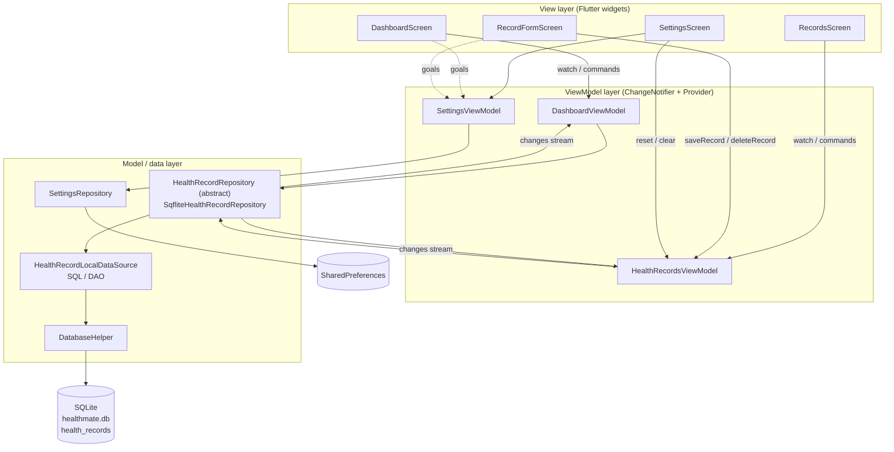
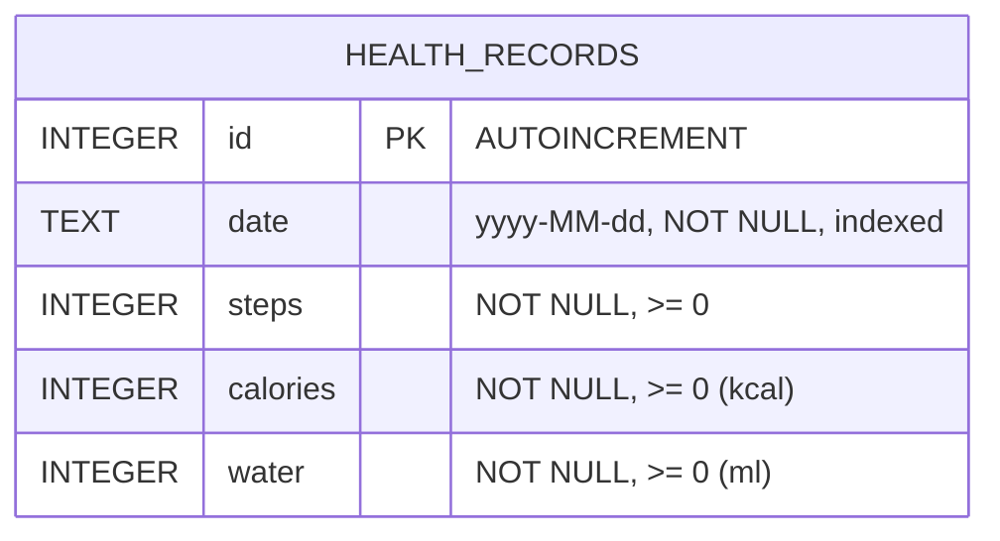

# HealthMate – Personal Health & Wellness Tracker

HealthMate is a cross-platform Flutter app for logging and reviewing daily health activity: **steps walked**, **calories burned** and **water intake**. Every record lives on the device in an embedded **SQLite** database (`sqflite`). The app follows the **MVVM** pattern with **Provider** for state management, and the code is organised by **feature**.

> Example "today" view:
> **Today – 18 August 2026** · 👣 Steps **7,850** · 🔥 Calories Burned **420 kcal** · 💧 Water Intake **2,000 ml**

---

## Table of contents

1. [Features](#1-features)
2. [Getting started](#2-getting-started)
3. [Application architecture](#3-application-architecture)
4. [State management](#4-state-management)
5. [Database design](#5-database-design)
6. [CRUD implementation](#6-crud-implementation)
7. [UI / UX design](#7-ui--ux-design)
8. [Third-party libraries](#8-third-party-libraries)
9. [Testing](#9-testing)
10. [Issues encountered & fixes](#10-issues-encountered--fixes)
11. [Version control](#11-version-control)

---

## 1. Features

### Core requirements

| Requirement | Where it is implemented |
|---|---|
| Add daily health entries (steps, calories, water) | **Add Record** screen (`record_form_screen.dart`), with validation |
| View past records with dates | **Records** tab: entries grouped by day, newest first |
| Update or delete records | Tap a record to edit it. Delete via swipe, the ⋮ menu, or the edit screen (all confirmed, with **Undo**) |
| Search / filter by date | Filter chips: *All*, *Today*, *Last 7 days*, *Last 30 days*, **Pick date** (single date) and **Date range** |
| Summary dashboard | **Dashboard** tab: today's totals for steps, calories and water |

### Additional features

- **Daily goals with progress rings.** Users can edit their goals; the defaults are 10,000 steps, 500 kcal and 2,500 ml.
- **7-day trend chart.** Built with `fl_chart`. Users switch between metrics, and a dashed line marks the goal. Below the chart: daily average, best day, and the number of days the goal was reached.
- **Logging streak.** Counts consecutive days with at least one entry.
- **Quick-add water** (+250 / +500 / +750 ml) from the dashboard, plus water presets on the form.
- **Multiple entries per day.** The dashboard and day headers show daily totals, calculated in SQL with `GROUP BY`.
- **Swipe-to-delete with Undo** and an optimistic UI update.
- **Unsaved-changes guard** when leaving the form.
- **Light / Dark / System theme**, saved between sessions.
- **Restore sample data** and **delete all records** from Settings.
- Sort toggle (newest or oldest first), pull-to-refresh, and empty, loading and error states.

---

## 2. Getting started

**Requirements:** Flutter 3.38+ (developed with Flutter 3.47 / Dart 3.13), Android SDK 36, and JDK 17+.

Install dependencies:

```bash
flutter pub get
```

Run the app on a connected device or emulator:

```bash
flutter run
```

Run all unit and widget tests:

```bash
flutter test
```

Run static analysis (should report no issues):

```bash
flutter analyze
```

Build the release APK:

```bash
flutter build apk --release
```

The release APK is written to `build/app/outputs/flutter-apk/app-release.apk`.

> **Release signing:** for coursework convenience, the release build is signed with the default debug key (Flutter template default). To publish on Google Play, create an upload keystore and configure `signingConfigs` in `android/app/build.gradle.kts`.

On the first launch the database is created and seeded with about three weeks of **dummy records**, so the dashboard, list and chart have data straight away. You can restore this data at any time from **Settings → Restore sample data**.

---

## 3. Application architecture

HealthMate uses **MVVM (Model–View–ViewModel)** with a **Repository** layer, organised **by feature**.



**Data flow example (adding a record):**
`RecordFormScreen` validates input → `HealthRecordsViewModel.saveRecord()` → `HealthRecordRepository.addRecord()` → `HealthRecordLocalDataSource.insert()` → SQLite `INSERT`. The repository then emits on its `changes` stream, and **both** the records list and the dashboard reload automatically.

### Folder structure

```
lib/
├── main.dart                      # Composition root: creates DB, repositories
├── app.dart                       # MultiProvider + MaterialApp (themes, routes)
├── core/                          # Shared, feature-agnostic code
│   ├── constants/                 # App constants, colour palette
│   ├── database/                  # DatabaseHelper (schema), SampleData (seed)
│   ├── routing/                   # AppRouter (named routes)
│   ├── theme/                     # Material 3 light & dark themes
│   ├── utils/                     # Date helpers, formatters, validators
│   └── widgets/                   # Reusable widgets: dialogs, empty/error states
└── features/
    ├── health_records/
    │   ├── data/
    │   │   ├── models/            # HealthRecord, DailySummary, HealthMetric
    │   │   ├── datasources/       # HealthRecordLocalDataSource (SQL)
    │   │   └── repositories/      # HealthRecordRepository (+ sqflite impl)
    │   └── presentation/
    │       ├── viewmodels/        # HealthRecordsViewModel, DateFilter
    │       ├── screens/           # RecordsScreen, RecordFormScreen
    │       └── widgets/           # RecordCard, DateFilterBar, MetricInputField…
    ├── dashboard/
    │   └── presentation/          # DashboardViewModel, DashboardScreen, chart
    ├── settings/
    │   ├── data/                  # DailyGoals, SettingsRepository
    │   └── presentation/          # SettingsViewModel, SettingsScreen
    └── home/                      # HomeShell (bottom NavigationBar)
```

| Layer / folder | Responsibility |
|---|---|
| `core/database` | Opens SQLite, defines the schema, creates the index, seeds dummy data |
| `features/*/data/models` | Immutable models with `toMap()` / `fromMap()` conversion |
| `features/*/data/datasources` | The **only** place SQL is written (DAO) |
| `features/*/data/repositories` | Abstraction used by ViewModels. It wraps DB errors in friendly messages and broadcasts data changes |
| `features/*/presentation/viewmodels` | UI state and commands. No Flutter widgets, so they are fully unit-testable |
| `features/*/presentation/screens, widgets` | Pure UI. They observe ViewModels and forward user actions |
| `core/widgets`, `core/utils` | Code reused by several features |

---

## 4. State management

**Provider** with `ChangeNotifier` ViewModels.

- `HealthMateApp` registers the repository and three ViewModels in a `MultiProvider`. The concrete repositories are **injected through the constructor**, so tests can pass in-memory fakes.
- Screens use `context.watch<T>()` to rebuild when state changes, and `context.read<T>()` to call commands.
- `Selector<SettingsViewModel, ThemeMode>` rebuilds `MaterialApp` only when the theme mode changes.
- The repository exposes a broadcast `Stream<void> changes`, so ViewModels stay in sync without depending on each other. For example, *quick-add water* on the dashboard also refreshes the records list.
- ViewModels guard against out-of-order async results with a *load token*. This means a slow query can't overwrite the result of a newer filter.

Why Provider: it is the approach recommended in the Flutter documentation for simple app state. It needs little boilerplate, fits MVVM naturally (one `ChangeNotifier` per screen or feature), and is easy to test.

---

## 5. Database design

**Engine:** SQLite via `sqflite` · **File:** `healthmate.db` · **Version:** 1



| Field | Type | Constraints | Description |
|---|---|---|---|
| `id` | INTEGER | PRIMARY KEY AUTOINCREMENT | Unique identifier of the entry |
| `date` | TEXT | NOT NULL, indexed | Day of the activity in ISO-8601 `yyyy-MM-dd`. This format sorts correctly as text, so `BETWEEN` and `ORDER BY` work without conversion |
| `steps` | INTEGER | NOT NULL DEFAULT 0, CHECK ≥ 0 | Steps walked |
| `calories` | INTEGER | NOT NULL DEFAULT 0, CHECK ≥ 0 | Calories burned (kcal) |
| `water` | INTEGER | NOT NULL DEFAULT 0, CHECK ≥ 0 | Water intake in millilitres |

```sql
CREATE TABLE health_records (
  id       INTEGER PRIMARY KEY AUTOINCREMENT,
  date     TEXT    NOT NULL,
  steps    INTEGER NOT NULL DEFAULT 0 CHECK (steps >= 0),
  calories INTEGER NOT NULL DEFAULT 0 CHECK (calories >= 0),
  water    INTEGER NOT NULL DEFAULT 0 CHECK (water >= 0)
);
CREATE INDEX idx_health_records_date ON health_records (date);
```

**How the app talks to SQLite:** `DatabaseHelper` lazily opens the database once and caches the `Future<Database>`. The schema and dummy data are created in `onCreate`. The DAO uses sqflite's parameterised helpers (`insert`, `query`, `update`, `delete`) and `rawQuery` for aggregation. Values are always passed as `whereArgs`, never concatenated into SQL, which prevents SQL injection.

**Dummy data:** `SampleData.generate()` creates about 21 days of realistic records relative to *today*, with fixed randomness and some days split into two entries. They are inserted in one `batch` on first launch.

---

## 6. CRUD implementation

All SQL lives in `HealthRecordLocalDataSource`.

| Operation | Method | SQL (simplified) |
|---|---|---|
| **Create** | `insert(record)` | `INSERT INTO health_records (date, steps, calories, water) VALUES (?,?,?,?)` |
| **Read** (list / filter) | `getAll(from, to, newestFirst)` | `SELECT * … WHERE date >= ? AND date <= ? ORDER BY date DESC, id DESC` |
| **Read** (dashboard) | `getDailySummaries(from, to)` | `SELECT date, SUM(steps), SUM(calories), SUM(water), COUNT(*) … GROUP BY date` |
| **Update** | `update(record)` | `UPDATE health_records SET … WHERE id = ?` |
| **Delete** | `delete(id)` | `DELETE FROM health_records WHERE id = ?` |

```dart
// Read with an optional inclusive date range (used by the date filter)
Future<List<HealthRecord>> getAll({DateTime? from, DateTime? to, bool newestFirst = true}) async {
  final db = await _dbHelper.database;
  final where = <String>[]; final args = <Object?>[];
  if (from != null) { where.add('date >= ?'); args.add(AppDateUtils.toDbString(from)); }
  if (to != null)   { where.add('date <= ?'); args.add(AppDateUtils.toDbString(to)); }
  final rows = await db.query('health_records',
      where: where.isEmpty ? null : where.join(' AND '),
      whereArgs: args.isEmpty ? null : args,
      orderBy: 'date ${newestFirst ? 'DESC' : 'ASC'}, id ${newestFirst ? 'DESC' : 'ASC'}');
  return rows.map(HealthRecord.fromMap).toList();
}
```

**Validation** (`core/utils/validators.dart`) runs before anything reaches the database:

- Every field is required and must be a whole number (digits only).
- Steps must be between 0 and 100,000, calories between 0 and 10,000 kcal, and water between 0 and 10,000 ml.
- The date can't be in the future.
- Cross-field rule: at least one value must be greater than 0.
- The database's `CHECK` constraints are a second line of defence.

---

## 7. UI / UX design

- **Material 3** (`useMaterial3`) with a scheme generated from one seed colour (teal, a calm "health" colour). There are light and dark variants, and all three screens required by the brief are included.
- **Colour coding per metric**, used consistently on cards, inputs, chart and icons:
  - Steps: green (`directions_walk` icon)
  - Calories: red (`local_fire_department` icon)
  - Water: blue (`water_drop` icon)
- **Navigation:** a bottom `NavigationBar` with Dashboard, Records and Settings. An `IndexedStack` keeps each tab's scroll position and filter. *Add record* opens as a full-screen dialog; edit opens as a normal page.
- **Feedback:** confirmation dialogs for destructive actions, SnackBars with **Undo**, inline field errors that appear after the first submit, loading and empty states, and pull-to-refresh.
- **Accessibility:** semantic labels on metric values and progress cards, adequate touch targets (≥ 48 dp), and theme-derived text styles that respect the platform font and text scaling.
- **Reusable components:** `MetricIcon`, `MetricValueChip`, `MetricInputField`, `RecordCard`, `DateFilterBar`, `MetricProgressCard`, `WeeklyTrendChart`, `EmptyState`, `ErrorView`, `SectionHeader`, `showConfirmDialog`.

Screens:

- **Dashboard:** greeting, today's date, streak, three goal rings, quick-add water, 7-day chart with stats, and today's entries.
- **Records:** filter chips, a summary of the filtered set, records grouped by day with daily totals, swipe-to-delete, and a sort toggle.
- **Add / Edit Record:** date picker, three validated numeric fields with units and goal hints, water presets, and delete when editing.
- **Settings:** daily goals (validated dialog), theme, restore sample data, delete all, and About.

---

## 8. Third-party libraries

| Package | Purpose | Why it was chosen |
|---|---|---|
| [`sqflite`](https://pub.dev/packages/sqflite) | Embedded SQLite database | Required by the brief. It is the most widely used SQLite plugin for Flutter (Android and iOS), supports transactions, batches and raw SQL |
| [`provider`](https://pub.dev/packages/provider) | State management / dependency injection | Recommended by the Flutter team for app state. It is simple, fits MVVM, and makes it easy to inject fakes in tests |
| [`path`](https://pub.dev/packages/path) | Builds the database file path | Joins paths safely on every platform |
| [`intl`](https://pub.dev/packages/intl) | Date and number formatting | Formats `18 August 2026` and `7,850` in a locale-aware way |
| [`fl_chart`](https://pub.dev/packages/fl_chart) | Weekly bar chart | Customisable, pure Dart, animated, with tooltips and extra lines (used for the goal line) |
| [`shared_preferences`](https://pub.dev/packages/shared_preferences) | Stores goals and theme | Key/value preferences don't need a relational table |
| [`sqflite_common_ffi`](https://pub.dev/packages/sqflite_common_ffi) *(dev)* | Runs real SQLite in unit tests | Lets the SQL layer be tested on desktop or CI without an emulator |
| [`flutter_lints`](https://pub.dev/packages/flutter_lints) *(dev)* | Static analysis rules | Enforces the recommended Dart style; `flutter analyze` reports 0 issues |

---

## 9. Testing

There are **54 automated tests**: unit, integration (real SQLite through FFI) and widget tests. Run them all with `flutter test`.

| File | Covers |
|---|---|
| `test/unit/health_record_datasource_test.dart` | Schema and constraints, seeding, CRUD, date filtering, `GROUP BY` totals, repository change events |
| `test/unit/models_and_validators_test.dart` | `toMap`/`fromMap`, `copyWith`, every validator, date helpers, sample data |
| `test/unit/viewmodels_test.dart` | Filtering, grouping, save, update, delete and undo, error handling, dashboard totals, trend, streak, quick-add, settings persistence |
| `test/widget/app_flow_test.dart` | End-to-end UI journeys TC-01 … TC-10 below |

### Test cases

| Test ID | Test scenario | Input | Expected result | Actual result | Status |
|---|---|---|---|---|---|
| TC-01 | Dashboard shows today's summary | Launch app with today's entries 5,000 + 2,850 steps, 250 + 170 kcal, 1,200 + 800 ml | "Today – 18 August 2026" with 7,850 steps, 420 kcal, 2,000 ml, and the 7-day chart | As expected | Pass |
| TC-02 | Required-field validation | Open Add Record, tap *Add record* with empty fields | "Please enter Steps / Calories / Water intake (use 0 if none)"; nothing saved | As expected | Pass |
| TC-03 | Range and cross-field validation | Steps = 250000; then all fields = 0 | "Steps looks too high (max 100,000)"; then "Enter at least one value greater than 0"; nothing saved | As expected | Pass |
| TC-04 | Create record | Steps 1150, Calories 80, Water 500 for today | Form closes, "Record added" SnackBar; dashboard shows 9,000 steps and 2,500 ml | As expected | Pass |
| TC-05 | Read and filter by date | Open Records; tap *Today*; tap *All* | 4 records in day groups → 2 records ("2 entries") → 4 records | As expected | Pass |
| TC-06 | Update record | Tap the 6,400-step record, change steps to 6600, save | Record updated in DB and list shows 6,600 | As expected | Pass |
| TC-07 | Delete with confirmation and undo | ⋮ → Delete → confirm; then tap *Undo* | Confirmation dialog; record removed; Undo restores it | As expected | Pass |
| TC-08 | Quick-add water | Tap *+250 ml* on dashboard | Today's water rises from 2,000 to 2,250 ml; SnackBar shown | As expected | Pass |
| TC-09 | Edit daily goal with validation | Settings → Water goal → 0, then 3000 | "Goal cannot be less than 1"; then "3,000 ml per day" | As expected | Pass |
| TC-10 | Empty state | Launch with an empty database | Dashboard: "Nothing logged yet today"; Records: "No records yet" | As expected | Pass |

---

## 10. Issues encountered & fixes

| # | Problem | Cause | Fix |
|---|---|---|---|
| 1 | Two parts of the app could open the database twice at start-up | `_db ??= await open()` lets two callers both see `null` before the first `await` completes | Cache the **Future** instead: `_database ??= _open()`, so all callers share one connection |
| 2 | Switching filters quickly sometimes showed the wrong records | An earlier, slower query finished after a newer one and overwrote it | Each load gets an incrementing *token*; results from older tokens are ignored |
| 3 | Dashboard didn't update after editing a record on another tab | ViewModels were only reloaded on their own actions | The repository broadcasts a `changes` stream, and every ViewModel listens and refreshes |
| 4 | Several entries on one day made "today's water" ambiguous | The brief allows multiple daily entries | Totals are calculated in SQL with `SUM … GROUP BY date`; the list shows a per-day total header |
| 5 | AppBar titles and button labels didn't use the theme font | Their `TextStyle`s were created from scratch, so they had no font family | Derive them from the theme's `textTheme` with `copyWith` |
| 6 | Widget tests couldn't find widgets lower on the dashboard | `ListView` builds children lazily, so off-screen widgets don't exist yet | Use `scrollUntilVisible` and centre the target before tapping; a FAB had also been covering a button |
| 7 | Gradle build failed with HTTP 429 (Too Many Requests) from Maven Central | Rate limiting on the build machine's network | Retried through Google's Maven Central mirror using a user-level Gradle init script (no project change needed) |

---

## 11. Version control

The project is developed with Git using small, descriptive commits that show progressive development (scaffold → data layer → view models → UI → polish → docs). View the history with:

```bash
git log --oneline
```

---

*HealthMate is a coursework project for Mobile Application Development (Kingston University BSc (Hons) top-up).*
