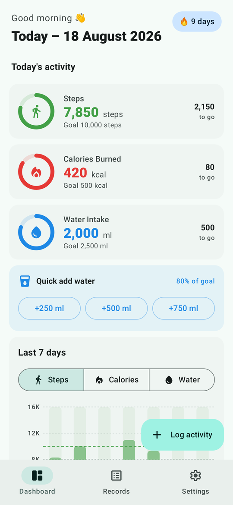
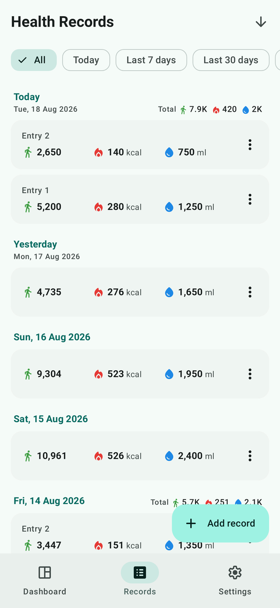
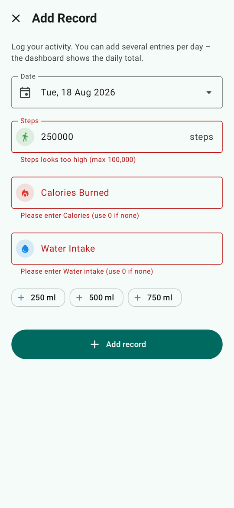
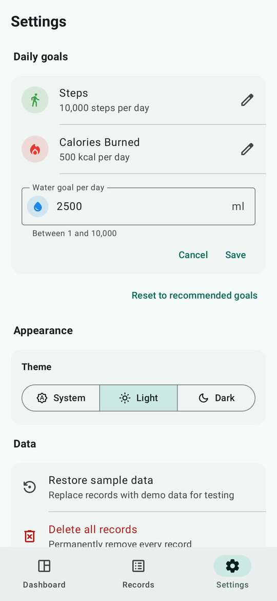
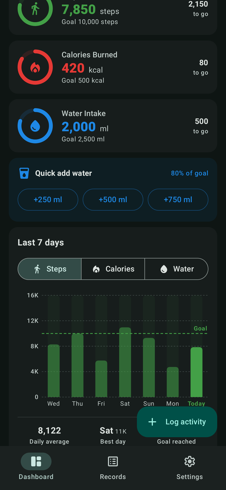
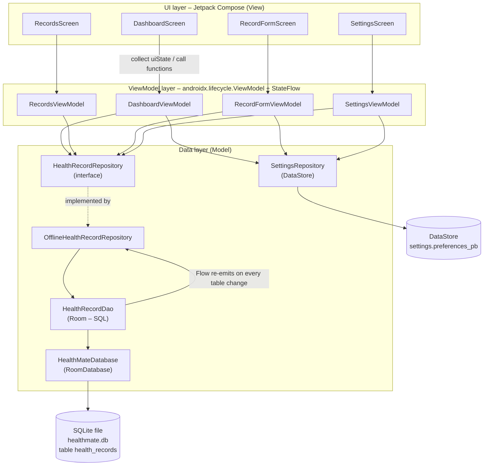
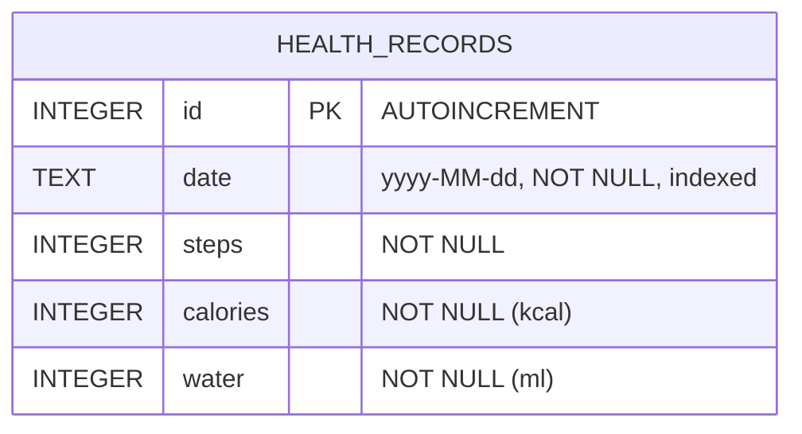

# HealthMate – Personal Health & Wellness Tracker

HealthMate is a **native Android app** (Kotlin, Jetpack Compose, Material 3) for recording and reviewing daily health activity: **steps walked**, **calories burned** and **water intake**. All data is stored on the device in an embedded **SQLite** database through **Room**. The app follows the **MVVM** pattern with a **feature-based** package structure.

> **Today – 18 August 2026** · 👣 Steps **7,850** · 🔥 Calories Burned **420 kcal** · 💧 Water Intake **2,000 ml**

| Dashboard | Records | Add record (validation) | Settings | Dark mode |
|---|---|---|---|---|
|  |  |  |  |  |

---

## Contents

1. [Features](#1-features)
2. [Open, run and build in Android Studio](#2-open-run-and-build-in-android-studio)
3. [Application architecture](#3-application-architecture)
4. [State management](#4-state-management)
5. [Database design](#5-database-design)
6. [CRUD implementation](#6-crud-implementation)
7. [UI / UX design](#7-ui--ux-design)
8. [Libraries](#8-libraries)
9. [Testing](#9-testing)
10. [Issues encountered & fixes](#10-issues-encountered--fixes)
11. [Version control](#11-version-control)

---

## 1. Features

### Core requirements

| Requirement | Implementation |
|---|---|
| Add daily health entries (steps, calories, water) | **Add Record** screen with field and form validation |
| View past records with dates | **Records** tab: entries grouped by day, with the day's totals |
| Update or delete records | Tap a record to edit it. Delete by swiping, from the ⋮ menu or from the edit screen; every delete is confirmed and can be undone |
| Search / filter records by date | Filter chips (*All*, *Today*, *Last 7 days*, *Last 30 days*) plus a Material **date picker** and **date-range picker** |
| Summary dashboard | **Dashboard** tab showing today's totals for steps, calories and water |

### Additional features

- **Daily goals** shown as animated progress rings. Goals are editable in Settings and stored with DataStore.
- **7-day bar chart** drawn on a Compose `Canvas`:
  - switch between metrics
  - dashed goal line, with today's bar highlighted
  - tap a bar to see its value
  - stats below the chart: daily average, best day, days the goal was reached
- **Logging streak:** consecutive days with at least one entry.
- **Quick-add water** buttons (+250 / +500 / +750 ml) on the dashboard, and water presets on the form.
- **Multiple entries per day**, totalled in SQL with `GROUP BY`.
- **Swipe-to-delete with Undo**, and a **discard-changes guard** on the form.
- **Light / Dark / System** theme, applied to the system bars too.
- **Restore sample data** and **Delete all records** in Settings.
- **Accessibility:** content descriptions on values and icons, 48 dp touch targets, and Material type scale support for font scaling.

---

## 2. Open, run and build in Android Studio

**Requirements:** Android Studio (Ladybug or newer; tested with AGP 8.13), JDK 17+ (the JDK bundled with Android Studio works), and Android SDK 36.

1. **Open the project.** In Android Studio choose **File → Open** and select this folder, the one that contains `settings.gradle.kts`. Wait for the Gradle sync to finish.
2. **Run the app.** Select an emulator or a USB-connected phone (Android 8.0 / API 26 or newer) and click **Run ▶**.
3. **Build a release APK.** Choose **Build → Build App Bundle(s) / APK(s) → Build APK(s)** with the *release* build variant, or use the command line below. The APK is written to `app/build/outputs/apk/release/app-release.apk`.
4. **Run the tests.** Right-click `app/src/test` and choose **Run 'Tests in …'**, or use the command line below. The tests run on the JVM with Robolectric, so no emulator is needed.

Build the release APK from the command line:

```bash
./gradlew assembleRelease
```

Run all unit, database and UI tests:

```bash
./gradlew testDebugUnitTest
```

Run Android Lint:

```bash
./gradlew lintDebug
```

Optionally, regenerate the screenshots in `app/build/screenshots`:

```bash
./gradlew testDebugUnitTest --tests "*ScreenshotCaptureTest*" -PcaptureScreenshots=true
```

> **Signing:** for coursework convenience, `release` is signed with the local *debug* key, so `assembleRelease` produces an installable APK. To publish on Google Play, use **Build → Generate Signed App Bundle / APK** with your own upload key.

On first launch, the database is created and seeded with about three weeks of **dummy records**, so the dashboard, list and chart have data immediately. Use **Settings → Restore sample data** to reset them at any time.

---

## 3. Application architecture

HealthMate uses **MVVM (Model–View–ViewModel)** with a **Repository** layer, as recommended in Google's *Guide to app architecture*. The code is organised **by feature**.



**Data flow, from adding a record to seeing it:**

1. `RecordFormScreen` sends input to `RecordFormViewModel`, which validates it.
2. The ViewModel calls `repository.addRecord()`, which calls `HealthRecordDao.insert()`, which runs an SQLite `INSERT`.
3. Room notices the table changed and **re-emits every `Flow` query** that reads it.
4. The dashboard's and records list's `uiState` update, and Compose recomposes. No manual refresh is needed.

### Package structure

```
app/src/main/java/net/orbitratech/healthmate/
├── HealthMateApplication.kt        Application – owns the DI container
├── MainActivity.kt                 Single activity, hosts Compose, edge-to-edge
├── di/
│   ├── AppContainer.kt             Manual dependency injection (DB, repositories, clock)
│   └── AppViewModelProvider.kt     ViewModel factory for all screens
├── navigation/
│   ├── HealthMateApp.kt            Root composable: theme, Scaffold, NavigationBar, NavHost
│   └── HealthMateDestinations.kt   Routes and arguments
├── core/                           Shared, feature-agnostic code
│   ├── database/                   HealthMateDatabase (Room), SampleData (seed)
│   ├── designsystem/theme/         Material 3 colour scheme, typography, shapes
│   ├── designsystem/component/     Reusable composables (dialogs, empty states, icons, snackbar)
│   └── util/                       DateUtils, Formatters, Validators
└── feature/
    ├── records/
    │   ├── model/                  HealthRecord, DailySummary, HealthMetric (domain models)
    │   ├── data/                   HealthRecordEntity, HealthRecordDao, HealthRecordRepository
    │   └── ui/ list/ form/ component/   RecordsScreen/ViewModel, RecordFormScreen/ViewModel, RecordCard
    ├── dashboard/ui/               DashboardScreen, DashboardViewModel, MetricProgressCard, WeeklyBarChart
    └── settings/
        ├── data/                   SettingsRepository (DataStore), DailyGoals, ThemeMode
        └── ui/                     SettingsScreen, SettingsViewModel, AppViewModel
```

| Layer | Responsibility |
|---|---|
| **Entity / DAO** (`feature/records/data`) | The *only* place SQL is written. Room checks every query at compile time. |
| **Repository** | The single access point for ViewModels. It maps entities to domain models and turns database errors into friendly `RepositoryException` messages. |
| **Domain models** (`feature/records/model`) | Immutable `data class`es using `LocalDate`, so the UI never sees the database's text date format. |
| **ViewModels** | Hold UI state as `StateFlow`, run validation, and expose commands. They contain no Android View code, so they are unit-testable on the JVM. |
| **Screens** (Compose) | Pure UI. Each screen has a *stateful* wrapper that collects the ViewModel, and a *stateless* `…Content` composable that takes plain state and callbacks. |
| **core** | Code shared by several features. |

---

## 4. State management

The app uses **Jetpack ViewModel + Kotlin `StateFlow`**, which is the native Android equivalent of Provider or Riverpod.

- Each screen has a ViewModel that exposes a single immutable **UI state** (`DashboardUiState`, `RecordsUiState`, `RecordFormUiState`), built reactively with `combine` / `flatMapLatest` / `stateIn` from Room `Flow`s and user input.
- Composables read state with `collectAsStateWithLifecycle()`. Collection stops automatically when the app is in the background.
- **Unidirectional data flow:** state flows down, and events (clicks, text input) flow up as function calls (`viewModel.save()`, `viewModel.setFilter(...)`).
- **One-off events** (navigate back, show a snackbar with *Undo*) go through a `Channel` and are collected with `repeatOnLifecycle`, so they are never lost or handled twice.
- `RecordsViewModel` and `DashboardViewModel` are **activity-scoped** and shared between tabs. For example, *See all* on the dashboard sets the records filter. `RecordFormViewModel` is scoped to its navigation destination and receives the record id from `SavedStateHandle`.
- On resume, ViewModels refresh their "today" date so the dashboard rolls over correctly after midnight.

---

## 5. Database design

**Engine:** SQLite through Room 2.8 · **File:** `healthmate.db` · **Version:** 1 · **Schema export:** `app/schemas/…/1.json`

The brief names `sqflite`, which is Flutter's SQLite plugin. In a native Android app the equivalent is the same embedded SQLite engine, accessed through Room, Google's official abstraction over `SQLiteOpenHelper`.



| Field | SQLite type | Constraints | Description |
|---|---|---|---|
| `id` | INTEGER | PRIMARY KEY AUTOINCREMENT | Unique id of the entry |
| `date` | TEXT | NOT NULL, index `index_health_records_date` | Activity day in ISO-8601 `yyyy-MM-dd`. This format sorts correctly as text, so `ORDER BY date` and `BETWEEN` work directly in SQL. |
| `steps` | INTEGER | NOT NULL | Steps walked |
| `calories` | INTEGER | NOT NULL | Calories burned (kcal) |
| `water` | INTEGER | NOT NULL | Water intake in millilitres |

The SQL that Room generates (from the exported schema):

```sql
CREATE TABLE IF NOT EXISTS `health_records` (
  `id` INTEGER PRIMARY KEY AUTOINCREMENT NOT NULL,
  `date` TEXT NOT NULL, `steps` INTEGER NOT NULL,
  `calories` INTEGER NOT NULL, `water` INTEGER NOT NULL);
CREATE INDEX IF NOT EXISTS `index_health_records_date` ON `health_records` (`date`);
```

**How the app talks to SQLite:**

- `HealthMateDatabase.create()` builds the database once, lazily, in `AppContainer`.
- `@Entity HealthRecordEntity` defines the table.
- `@Dao HealthRecordDao` declares the SQL. Room generates the implementation at compile time with KSP and validates every query against the schema, so a typo in a column name is a build error.
- Write operations are `suspend` functions that run off the main thread.
- Read queries return `Flow`s that re-emit whenever the table changes.
- Values are always bound as parameters (`:from`, `:to`), never concatenated into SQL, which prevents SQL injection.

**Dummy data:** `HealthMateDatabase.SeedCallback.onCreate()` inserts about 21 days of realistic records the first time the database is created. Today's records match the brief's example: 7,850 steps, 420 kcal and 2,000 ml.

---

## 6. CRUD implementation

```kotlin
@Dao
interface HealthRecordDao {
    @Insert(onConflict = OnConflictStrategy.ABORT)
    suspend fun insert(record: HealthRecordEntity): Long                  // CREATE

    @Query("""SELECT * FROM health_records
              WHERE (:from IS NULL OR date >= :from) AND (:to IS NULL OR date <= :to)
              ORDER BY date DESC, id DESC""")
    fun observeRecords(from: String?, to: String?): Flow<List<HealthRecordEntity>>   // READ + date filter

    @Query("""SELECT date, SUM(steps) AS steps, SUM(calories) AS calories,
                     SUM(water) AS water, COUNT(*) AS entryCount
              FROM health_records WHERE date BETWEEN :from AND :to
              GROUP BY date ORDER BY date ASC""")
    fun observeDailySummaries(from: String, to: String): Flow<List<DailySummaryRow>> // dashboard totals

    @Update suspend fun update(record: HealthRecordEntity): Int           // UPDATE

    @Query("DELETE FROM health_records WHERE id = :id")
    suspend fun deleteById(id: Long): Int                                 // DELETE
}
```

| Operation | UI | ViewModel | Repository / DAO |
|---|---|---|---|
| Create | Add Record form → *Add record* | `RecordFormViewModel.save()` | `addRecord()` → `insert()` |
| Read | Records list, Dashboard | `RecordsViewModel.uiState`, `DashboardViewModel.uiState` | `observeRecords()`, `observeDailySummaries()` |
| Update | Tap a record → *Save changes* | `RecordFormViewModel.save()` | `updateRecord()` → `update()` (fails clearly if the row no longer exists) |
| Delete | Swipe, ⋮ → Delete, or 🗑 on the edit screen | `RecordsViewModel.deleteRecord()` / `restoreRecord()` (Undo) | `deleteRecord()` → `deleteById()` |

**Validation** (`core/util/Validators.kt`, unit-tested) runs before anything is saved:

- Each field is required and must be a whole number. Non-digits are stripped as the user types.
- Ranges:
  - steps: 0–100,000
  - calories: 0–10,000 kcal
  - water: 0–10,000 ml
- The date must be present and not in the future. The date pickers also disable future dates.
- Cross-field rule: at least one value must be greater than 0.
- Errors only appear after the first *Save* attempt, then update live as the user types.

---

## 7. UI / UX design

- **Material 3 / Material You components** throughout:
  - `TopAppBar`, `NavigationBar`, `ExtendedFloatingActionButton`
  - `Card`, `FilterChip`, `SegmentedButton`
  - `OutlinedTextField`, `DatePickerDialog` / `DateRangePicker`
  - `SwipeToDismissBox`, `AlertDialog`, `Snackbar`
- The design follows Android's edge-to-edge guidance and supports a light and a dark colour scheme generated from a teal seed colour, a calm "health" colour.
- **Colour coding per metric**, used consistently on cards, inputs, chart and icons:
  - Steps: **green**, *walk* icon
  - Calories: **red**, *flame* icon
  - Water: **blue**, *drop* icon
- **Icons:** Google *Material Symbols (Rounded)* imported as vector drawables, the same way Android Studio's *Vector Asset* tool does.
- **Navigation:**
  - A bottom `NavigationBar` holds the three tabs: Dashboard, Records and Settings.
  - Each tab keeps its scroll position and filter.
  - The add/edit form opens as a full screen without the bottom bar. The system back gesture is guarded when there are unsaved changes.
- **Feedback:** confirmation dialogs for destructive actions, snackbars with **Undo**, inline errors, empty, loading and error states, and an animated chart and progress rings.
- **Reusable components:** `MetricIcon`, `MetricValue`, `RecordCard`, `DateFilterBar`, `MetricProgressCard`, `WeeklyBarChart`, `EmptyState`, `ErrorState`, `ConfirmDialog`, `SectionHeader`, `AppSnackbar`.

The screens are shown in [`docs/screenshots`](docs/screenshots):

- **Dashboard:** greeting, today's date, streak, three goal rings, quick-add water, 7-day chart with stats, and today's entries.
- **Records:** filter chips, a summary of the filtered set, day groups with totals, swipe-to-delete, and a sort toggle.
- **Add / Edit Record:** date picker, three validated numeric fields with units and goal hints, water presets, and delete when editing.
- **Settings:** inline daily-goal editor with validation, theme selector, restore sample data, delete all, and About.

---

## 8. Libraries

All libraries are official Android Jetpack (AndroidX) or Kotlin libraries, declared in the version catalog `gradle/libs.versions.toml`.

| Library | Purpose | Why it was chosen |
|---|---|---|
| **Jetpack Compose + Material 3** (BOM 2026.06.01) | Declarative UI and Material Design components | Google's recommended UI toolkit for new Android apps. It has built-in Material 3 theming and dark mode, and needs less code than XML layouts. |
| **Room** 2.8.5 (`room-runtime`, `room-ktx`, `room-compiler` via **KSP**) | Embedded SQLite database | Official SQLite abstraction. It checks SQL at compile time, supports coroutines and `Flow`, and exports the schema for migrations. |
| **Lifecycle ViewModel / runtime-compose** 2.10.0 | ViewModels and lifecycle-aware state collection | Survives configuration changes; `collectAsStateWithLifecycle` stops work in the background. |
| **Navigation Compose** 2.9.5 | Screen navigation and arguments | Back stack, saved tab state and `SavedStateHandle` arguments for the edit screen. |
| **DataStore Preferences** 1.2.1 | Goals and theme preferences | Asynchronous and transactional; the recommended replacement for SharedPreferences. |
| **Kotlin Coroutines / Flow** | Background database work and reactive streams | Structured concurrency, and the main thread is never blocked. |
| *Test:* **JUnit 4**, **Robolectric** 4.16, **Compose UI Test**, **kotlinx-coroutines-test**, **Room testing** | Unit, database and UI tests on the JVM | Fast tests with real SQLite and real Compose rendering, no emulator needed. |

Versions are pinned to the newest releases that work with **AGP 8.13 / compileSdk 36**. Some newer AndroidX releases require AGP 9 and compileSdk 37, which older Android Studio installations can't open. Lint's remaining *"newer version available"* warnings refer to those deliberately pinned versions.

---

## 9. Testing

**49 automated tests**, all run with `./gradlew testDebugUnitTest`. A further 5 screenshot-capture tests run only on request.

| Test class | Type | What it covers |
|---|---|---|
| `data/HealthRecordDaoTest` | Integration (real SQLite in memory) | Table columns, insert/read/update/delete, date-range filtering, `GROUP BY` totals, first-run seeding, repository mapping and error handling |
| `util/ValidatorsTest` | Unit | Every validation rule, date and number formatting, sample data |
| `ui/ViewModelsTest` | Unit (fake repositories) | Filtering, grouping, sorting, delete and undo, dashboard totals, trend, streak and goals, quick-add water, form validation, editing, settings |
| `ui/AppFlowTest` | Compose UI (Robolectric) | End-to-end user journeys TC-01 … TC-10 below |
| `ui/AppLaunchTest` | Smoke test | Launches the real `MainActivity` with the real Room database and DataStore, checks the seeded data, and saves a new record |

### Test cases

| Test ID | Test scenario | Input | Expected result | Actual result | Status |
|---|---|---|---|---|---|
| TC-01 | Dashboard shows today's summary | Launch with today's entries 5,000 + 2,850 steps, 250 + 170 kcal, 1,200 + 800 ml | "Today – 18 August 2026"; 7,850 steps, 420 kcal, 2,000 ml; 7-day chart present | As expected | Pass |
| TC-02 | Required-field validation | Open Add Record, tap *Add record* with empty fields | "Please enter Steps / Calories / Water intake (use 0 if none)"; nothing saved | As expected | Pass |
| TC-03 | Range and cross-field validation | Steps = 250000; then all fields = 0 | "Steps looks too high (max 100,000)"; then "Enter at least one value greater than 0"; nothing saved | As expected | Pass |
| TC-04 | Create a record | Steps 1150, Calories 80, Water 500 for today | Form closes; record saved; dashboard shows 9,000 steps and 2,500 ml | As expected | Pass |
| TC-05 | Read and filter by date | Open Records; tap *Today*; tap *All* | 4 records in day groups → 2 records ("2 entries · 1 day") → 4 records | As expected | Pass |
| TC-06 | Update a record | Tap the 6,400-step record, change to 6600, *Save changes* | Database row updated; list shows 6,600 | As expected | Pass |
| TC-07 | Delete with confirmation and undo | ⋮ → Delete → confirm; tap *Undo* | Confirmation dialog; record removed; "Record deleted" snackbar; Undo restores it | As expected | Pass |
| TC-08 | Quick-add water | Tap *+250 ml* on the dashboard | Today's water rises from 2,000 to 2,250 ml | As expected | Pass |
| TC-09 | Edit a daily goal with validation | Settings → Water goal → 0, *Save*; then 3000 | "Goal cannot be less than 1"; then "3,000 ml per day" | As expected | Pass |
| TC-10 | Empty states | Launch with an empty database | Dashboard: "Nothing logged yet today…"; Records: "No records yet" | As expected | Pass |

---

## 10. Issues encountered & fixes

| # | Problem | Cause | Fix |
|---|---|---|---|
| 1 | The app crashed with a `NullPointerException` when building the filter chips (found by the UI tests) | `DateFilter.presets` was a stored property in the sealed interface's `companion object`. Initialising it touched the nested `data object`s while their classes were still initialising, so the list contained `null`. | Changed `presets` to a getter (`get() = listOf(...)`), so it is built only when used |
| 2 | Vector icons failed to compile: `attr/colorControlNormal not found` | Imported icons used the AppCompat attribute `?attr/colorControlNormal`, but the app doesn't depend on AppCompat | Use the framework attribute `?android:attr/colorControlNormal` |
| 3 | Newer AndroidX libraries refused to build (`minCompileSdk=37`, `minAndroidGradlePluginVersion=9.1.0`) | The latest releases require AGP 9 / compileSdk 37 | Checked each library's AAR metadata and pinned the newest versions that support AGP 8.13 / SDK 36 |
| 4 | UI test never became idle when editing a goal in a dialog | A focused text field's blinking cursor runs an endless animation in a separate dialog window, which Robolectric's idle check can't settle | Redesigned goal editing as an **inline editor** inside the Settings card. It works in the main window and keeps the user in context |
| 5 | Screen and dashboard could disagree after edits | Data was loaded once per screen | All reads are Room `Flow`s, so every observer updates automatically after any write |
| 6 | "Today" was wrong if the app stayed open past midnight | The date was read once at start-up | ViewModels refresh "today" on `ON_RESUME` |
| 7 | Gradle and Robolectric downloads failed with HTTP 429 (Too Many Requests) | Rate limiting from Maven Central on the build machine's network | Used Google's Maven Central mirror through a user-level Gradle init script and an optional `robolectricRepoUrl` Gradle property; no project change needed elsewhere |
| 8 | `captureToImage()` timed out in screenshot tests | Robolectric doesn't deliver the window frame callback that it waits for | Draw the activity's `decorView` onto a `Bitmap` using Robolectric's native graphics mode |

---

## 11. Version control

The project is developed with Git using small, descriptive commits that show progressive development: project setup → data layer → ViewModels → UI → lint and smoke tests → documentation. View the history with:

```bash
git log --oneline
```

---

*HealthMate is a coursework project for Mobile Application Development (Kingston University BSc (Hons) top-up).*
